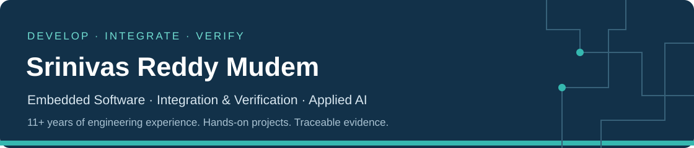

## Software that works. Evidence that shows it.

I'm **Srinivas Reddy Mudem**, a software engineer with **11+ years in embedded development, integration and technical project leadership**. My experience spans smart-access systems, camera ECUs, AUTOSAR diagnostics and low-level drivers.

I develop software, investigate integration problems and bring teams together to deliver working systems. My personal projects extend that work into **automated verification, build reliability and domain-specific AI**.

**[Explore my engineering portfolio →](https://github.com/SrinivasReddyMudem/engineering-portfolio)** · **[Connect on LinkedIn ↗](https://www.linkedin.com/in/srinivas-reddy-mudem-400181152/)**

---

## See my engineering work

### Embedded Communication & Diagnostics

**Follow a message from sender to receiver—and see what happens when something goes wrong.**

I integrated an existing C ISO-TP implementation with two host endpoints, frame tracing, controlled faults and repeatable verification.

**Recorded result:** 5/5 application bytes matched · 17/17 behavioral assertions passed.

`C` · `ISO-TP` · `GCC / Clang` · `CMake / CTest` · `Python`

**[See the demonstration and evidence →](https://github.com/SrinivasReddyMudem/engineering-portfolio/blob/main/case-studies/embedded-communication.md)**

Local C execution with replayed recorded frames; the demonstration does not use physical CAN hardware.

### Embedded Build Reliability

**A successful build is only the beginning. Tests must catch incorrect behavior.**

I integrated Zephyr RTOS tests into an isolated Jenkins/Docker workflow, injected a controlled defect and verified the repair with the same assertions.

**Recorded result:** 10/10 passed → defect detected: 7 passed, 3 failed → recovery: 10/10 passed.

`Jenkins` · `Docker` · `Zephyr RTOS` · `Twister / Ztest` · `Python`

**[Inspect the failure and verified recovery →](https://github.com/SrinivasReddyMudem/engineering-portfolio/blob/main/case-studies/failure-to-recovery.md)**

### Domain-Specific AI Agents

**Make engineering questions easier to investigate: what is known, what is missing, and what should be checked next?**

I built a Python application with **13 specialist agents and eight domain knowledge packs**, structured response schemas and targeted validation. Workflows cover embedded development, diagnostics, integration and engineering analysis.

**Software verification:** 441 offline checks passed with mocked provider responses. These test application behavior, rather than live AI accuracy.

`Python` · `Streamlit` · `Pydantic` · `pytest`

**[Try the live application ↗](https://automotive-skilled-ai-agents.streamlit.app/)** · **[Explore the engineering and validation →](https://github.com/SrinivasReddyMudem/engineering-portfolio/blob/main/case-studies/engineering-analysis.md)**

---

## Experience behind the projects

| Area | Professional experience |
| :--- | :--- |
| **Embedded development** | C/C++, ARM-based ECUs, low-level drivers, RTOS and AUTOSAR diagnostic software |
| **Integration & debugging** | ECU bring-up, BSP/application integration, multicore communication, trace and log analysis |
| **Verification & delivery** | Unit and integration testing, HIL, MISRA-C checks, Jenkins/QAC workflows and release coordination |
| **Technical leadership** | Software work packages, supplier coordination and cross-functional integration workshops |

<strong>Computer vision & synthetic-data work</strong>

My master's thesis at Audi Electronics Venture focused on camera-based pedestrian detection, using synthetic human models for dataset generation and VGG16/ResNet in Python/PyTorch for localisation and classification.

A personal Python pipeline extends this direction through synthetic pedestrian compositing, image processing and annotation validation.

## Let's connect

Interested in embedded development, integration, verification or engineering automation? **[Find me on LinkedIn](https://www.linkedin.com/in/srinivas-reddy-mudem-400181152/)** or **[browse the complete portfolio](https://github.com/SrinivasReddyMudem/engineering-portfolio)**.
